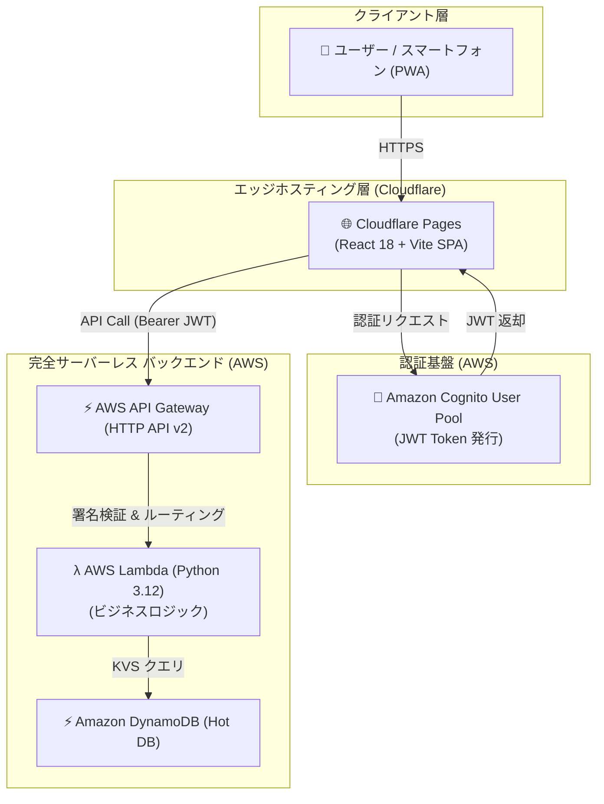

# 🏋️‍♂️ Matsuoka Fit Tracker (松岡フィットトラッカー)

> **KDDIアイレットの面接で知識不足が分かったことをきっかけに発起した、AWSサーバーレス × モダンフロントエンドのキャッチアッププロジェクト**

---

## 📑 目次
- [🏋️‍♂️ Matsuoka Fit Tracker (松岡フィットトラッカー)](#️️-matsuoka-fit-tracker-松岡フィットトラッカー)
  - [📑 目次](#-目次)
  - [1. プロジェクト概要](#1-プロジェクト概要)
  - [2. 開発の背景とストーリー](#2-開発の背景とストーリー)
  - [3. 開発プロセス：Geminiとの泥臭い壁打ち](#3-開発プロセスgeminiとの泥臭い壁打ち)
  - [4. システムアーキテクチャ](#4-システムアーキテクチャ)
  - [5. 技術スタック一覧](#5-技術スタック一覧)
  - [6. ディレクトリ構成](#6-ディレクトリ構成)
  - [7. ローカル起動・検証・デプロイ手順](#7-ローカル起動検証デプロイ手順)
    - [7.1 フロントエンド起動（デモモード内蔵）](#71-フロントエンド起動デモモード内蔵)
    - [7.2 AWS インフラのIaCデプロイ](#72-aws-インフラのiacデプロイ)
  - [8. 今後のロードマップと学習課題](#8-今後のロードマップと学習課題)

---

## 1. プロジェクト概要

**Matsuoka Fit Tracker** は、毎日の食事や筋力トレーニング、体重を記録・可視化できる Progressive Web App (PWA) です。
単なるフィットネスアプリの作成が目的ではなく、**AWSを用いた完全サーバーレスアーキテクチャと、Reactによるモダンなフロントエンド開発を、インフラからUIまで一気通貫で一人で構築しきる**ことを目的とした学習用プロジェクトです。

---

## 2. 開発の背景とストーリー

本プロジェクトは、KDDIアイレット様の面接を受けた際の「自分自身のスキルの現在地」に対する痛烈な気づきからスタートしました。

当時の私は、クラウドインフラ（AWS）のベストプラクティスやモダンなフロントエンド（React/Vite）からバックエンドまでのシームレスな繋ぎ込みに関して、知識としては知っていても「自分の手でイチから構築して運用した経験」が圧倒的に不足していることを痛感しました。

そこから、実際にサーバーレス基盤からフロントエンドまでを完全に一人で作り上げることで、知識を「使える技術」するために個人開発を行いました。

---

## 3. 開発プロセス：Geminiとの泥臭い壁打ち

このプロジェクトは、最初から綺麗なWBSを引いて、計画通りにスマートに進められたわけではありません。右も左も分からない状態から、**AI（Gemini）を強力なメンターとして活用し、ひたすら壁打ちを繰り返しながら進める**という、非常に泥臭いアプローチをとりました。

* **エラーとの格闘と対話:** AWS Lambdaの権限エラー、API GatewayとCognitoの連携でのCORSエラー、Reactの非同期処理の沼。詰まるたびにGeminiにエラーログを投げ、「なぜこうなるのか？」「ベストプラクティスは何か？」を問い続けました。
* **コードの意味を理解する:** 単にAIが出力したコードをコピペするのではなく「このCloudFormationの記述は何を意味しているのか」「DynamoDBのシングルテーブル設計はどう考えるべきか」を対話を通じて深く掘り下げました。
* **手探りでのアーキテクチャ構築:** 「とりあえず動く」状態からGeminiのアドバイスを受けながらAPI Gateway (HTTP API) の採用やIaC（Infrastructure as Code）の導入など徐々にモダンで堅牢な構成へとリファクタリングを重ねて今の形にたどり着きました。

---

## 4. システムアーキテクチャ

試行錯誤の末に構築した、完全サーバーレスのアーキテクチャです。待機コストを極小化しつつ、可用性を担保する構成を学びながら実装しました。



*(※将来的には、ローカルのProxmox上のPostgreSQLへのデータアーカイブ処理なども視野に入れています)*

---

## 5. 技術スタック一覧

今回の開発を通じてキャッチアップした主要な技術です。

| カテゴリ | 技術・ツール | キャッチアップのポイント |
|---|---|---|
| **Frontend** | **React 18** (Vite / TypeScript) | コンポーネントの分割、Hooksを用いた状態管理、型安全な開発 |
| **Styling** | **Tailwind CSS** + **Framer Motion** | ユーティリティクラスによる迅速なスタイリングと、マイクロインタラクションの実装 |
| **Hosting** | **Cloudflare Pages** | エッジネットワークを利用したSPAの高速デプロイ |
| **Authentication**| **AWS Cognito** + Amplify v6 | JWTを用いたセキュアな認証フローの実装 |
| **API Gateway** | **AWS API Gateway (HTTP API v2)** | Cognitoオーソライザーとの統合、CORS設定の理解 |
| **Backend** | **AWS Lambda** (Python 3.12 / Boto3) | サーバーレス環境でのビジネスロジック実装 |
| **Database** | **Amazon DynamoDB** | NoSQL特有のキー設計（パーティションキー、ソートキー）の理解 |
| **IaC** | **AWS CloudFormation / SAM** | 手動構築からの脱却。インフラのコード化と自動デプロイの実現 |

---

## 6. ディレクトリ構成

```text
matsuoka-fit-tracker/
├── spec.md                         # 開発仕様書（要件定義・API契約・DBスキーマ）
├── README.md                       # 本ドキュメント（ポートフォリオ解説・設計資料）
│
├── backend/                        # AWS サーバーレス バックエンド
│   ├── cloudformation_all_in_one.yaml # マネジメントコンソール用 1-Click 完全IaCテンプレート
│   ├── template.yaml               # AWS SAM 用インフラ定義
│   ├── samconfig.toml              # SAM デプロイ設定ファイル
│   ├── requirements.txt            # Python 依存ライブラリ (boto3 等)
│   ├── lambda_single_file.py       # インラインデプロイ用統合 Lambda ハンドラ
│   ├── src/
│   │   ├── app.py                  # Lambda エントリーポイント（ルーティング）
│   │   ├── handlers/               # 分割ハンドラ (get_records, post_diet, workout, body)
│   │   └── utils/                  # 共通ユーティリティ (Cognito検証・DynamoDB接続・レスポンス)
│   └── tests/
│       └── test_handlers.py        # バックエンド全エンドポイントの単体テスト
│
├── database/                       # 分析基盤 & Cold DB リソース
│   ├── init_postgres.sql           # PostgreSQL テーブル初期化 DDL (users, diet, workout)
│   └── n8n_workflow_sample.json    # DynamoDB ➔ PostgreSQL 定期同期パイプライン定義
│
└── frontend/                       # React 18 + Vite PWA フロントエンド
    ├── index.html                  # エントリー HTML（Japandi メタテーマ設定）
    ├── package.json                # フロントエンド依存関係定義
    ├── tsconfig.json               # TypeScript コンパイラ設定
    ├── vite.config.ts              # Vite ビルド設定
    ├── tailwind.config.js          # Japandi カラーテーマ拡張設定
    ├── dev.ps1                     # 高速ローカル開発サーバー起動スクリプト
    ├── deploy.ps1                  # Cloudflare Pages 自動ビルド＆デプロイスクリプト
    ├── .env.example                # 環境変数テンプレート
    └── src/
        ├── types/                  # 全データモデルの厳格な TypeScript 型定義
        ├── services/               # Cognito 認証・API 通信層 (デモモード自動判定内蔵)
        ├── hooks/                  # カスタムフック (データフェッチ・状態管理)
        ├── components/             # 再利用可能 UI コンポーネント群
        │   ├── common/             # LiquidTabs, AnimatedProgress 等のマイクロインタラクション
        │   ├── layout/             # Header, GooeyMenu 等のナビゲーション
        │   ├── dashboard/          # SummaryCards, PfcChart, BodyChart 等の可視化
        │   ├── forms/              # DietForm, WorkoutForm, BodyForm 入力フォーム
        │   └── history/            # タイムライン形式の記録履歴リスト
        └── pages/                  # LoginPage, DashboardPage メインビュー
```

---

## 7. ローカル起動・検証・デプロイ手順

### 7.1 フロントエンド起動（デモモード内蔵）

AWS環境の構築前でも動作確認ができるよう、サンプルデータを内蔵したデモモードを実装しました。

```bash
cd frontend
npm install
npm run dev
```
※ブラウザで `http://localhost:5173` にアクセスし、「🚀 デモモードで即時体験」をクリックしてください。

### 7.2 AWS インフラのIaCデプロイ

今回の開発で一番苦労し、かつ学びが大きかったのがインフラのコード化です。

```bash
cd backend
sam build
sam deploy --guided
```
デプロイ完了後、出力されたエンドポイントをフロントエンドの `.env.local` に設定することで結合されます。

---

## 8. 今後のロードマップと学習課題

ようやく一通りの形になりましたが、まだまだ学ぶべきことは多いと感じています。今後は以下の点に挑戦していく予定です。

* **CI/CDパイプラインの構築**: GitHub Actions等を用いた、テストからデプロイまでの完全自動化。
* **オフライン対応 (PWA)**: Service Workerのより深い理解と、オフライン時のデータ同期の実装。
* **可観測性の向上**: CloudWatchやX-Rayを活用したログ監視とパフォーンマンスチューニング。
* **WBSとスケジュール管理を用いた計画的開発**: 今後は要件をWBSに落とし込み、スケジュールやマイルストーンを明確に引いた上で実装を進める「実務を想定したプロジェクト進行」を実践。
* **MCPサーバーの構築とGemini連携 (AI駆動の入力UX):**記録の認知的負荷をさらに下げるため、MCPサーバーを構築。

このプロジェクトを通じて得た「自ら調べ、AIを活用しながらでも最後まで実装しきる力」を、今後の実務でも必ず活かしていきます。